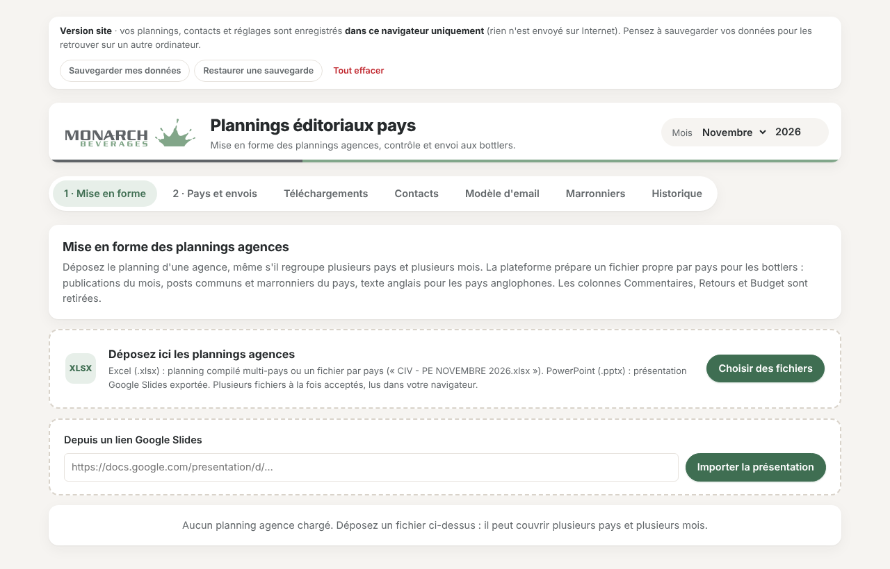

# Plannings éditoriaux pays

Outil de **Monarch Beverages** pour mettre en forme, contrôler et préparer l'envoi des plannings éditoriaux des agences aux bottlers, pays par pays.

**Ouvrir la plateforme : https://masterkarin99.github.io/PE-Monarch-Beverages/**

## Ce que fait la plateforme

1. **Mise en forme** : déposez le planning d'une agence (Excel, PowerPoint ou lien Google Slides), même s'il regroupe plusieurs pays et plusieurs mois. La plateforme produit un fichier propre par pays : un onglet par marque avec son logo, les colonnes Commentaires, Retours et Budget retirées, le texte anglais pour les pays anglophones.
2. **Contrôle** : marques distribuées et marronniers vérifiés pour chaque pays. Une vraie erreur (marque manquante, mauvaise marque, autre mois) est soulignée avec la correction à faire.
3. **Pays et envois** : statut de chaque pays (en attente, en révision, à corriger, prêt, envoyé), email prêt dans la langue du pays avec ses destinataires et le lien de téléchargement, brouillon Outlook (.eml) et packs .zip.
4. **Téléchargements** : tous les plannings mis en forme, mois par mois, à visualiser et télécharger.
5. **Contacts**, **Modèle d'email**, **Marronniers** et **Historique** : les réglages et le suivi.

## Où sont les données ?

Cette version fonctionne **entièrement dans le navigateur** : aucun serveur, rien n'est envoyé sur Internet. Les plannings, contacts et réglages sont enregistrés dans le navigateur de la personne qui les saisit (IndexedDB).

- **Sauvegarder mes données** (en haut de la page) télécharge un fichier `.json` avec tout le contenu.
- **Restaurer une sauvegarde** permet de retrouver ses données sur un autre ordinateur ou navigateur.
- **Tout effacer** vide les données de ce navigateur.

Au premier lancement, la plateforme est vide : importez votre fichier de contacts (onglet **Contacts**), votre calendrier marketing (onglet **Marronniers**) et renseignez l'expéditeur (onglet **Modèle d'email**).

## Ce que cette version ne fait pas

L'**Espace pays** des bottlers (téléchargement de leurs plannings et validation en ligne) a besoin d'un serveur partagé. Il est disponible dans la version hébergée, sur la branche [`version-serveur`](https://github.com/MasterKarin99/PE-Monarch-Beverages/tree/version-serveur) (Docker, connexion par lien email).

## Mettre en ligne avec GitHub Pages

Dans le dépôt : **Settings › Pages › Build and deployment**, source **Deploy from a branch**, branche **main**, dossier **/ (root)**, puis **Save**. Le site est en ligne quelques minutes plus tard à l'adresse ci-dessus.

## Technique

Un seul fichier `index.html` (HTML, CSS et JavaScript), avec [ExcelJS](https://github.com/exceljs/exceljs) et [JSZip](https://github.com/Stuk/jszip) chargés depuis cdnjs. Aucune installation, aucune donnée réelle dans le dépôt.
