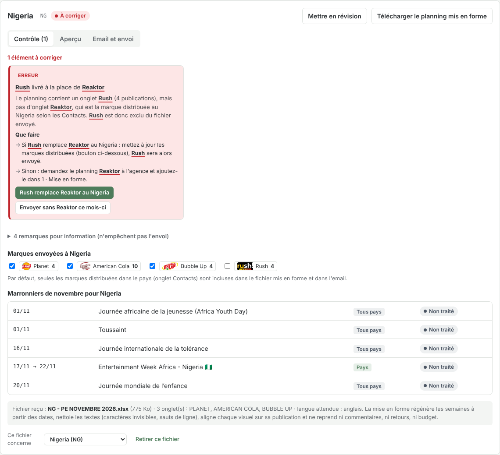
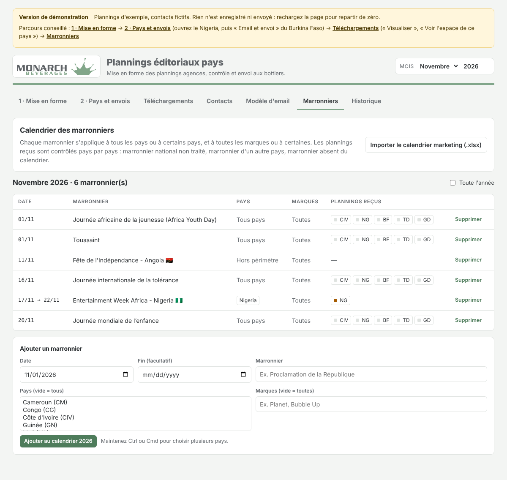
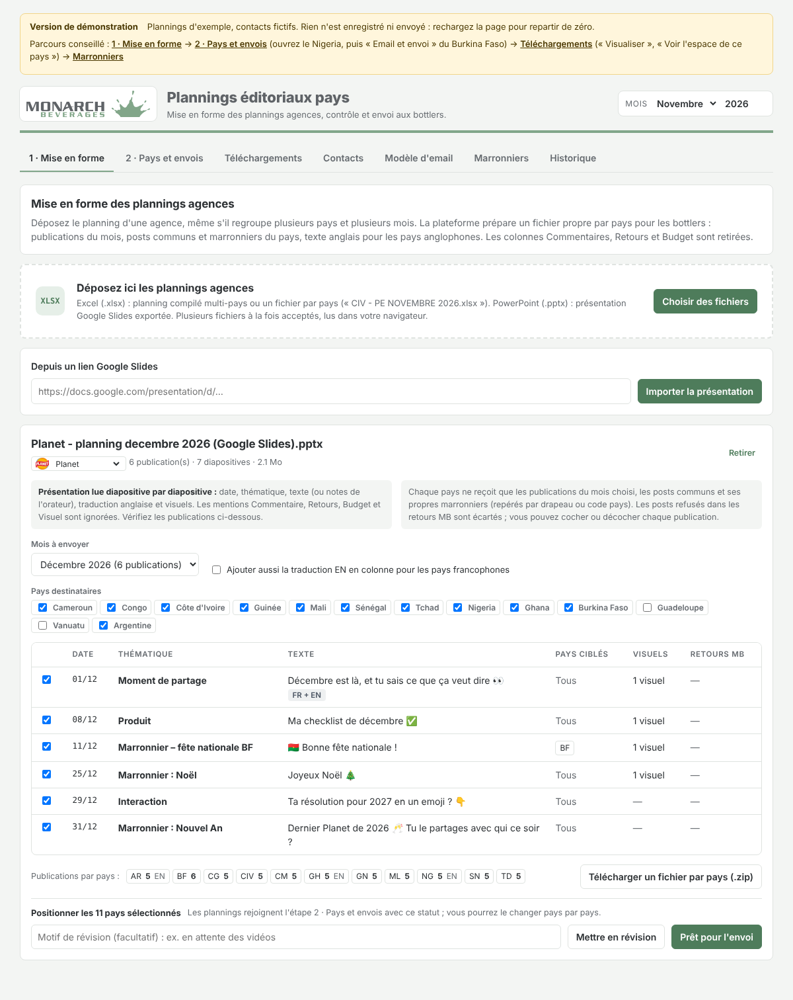
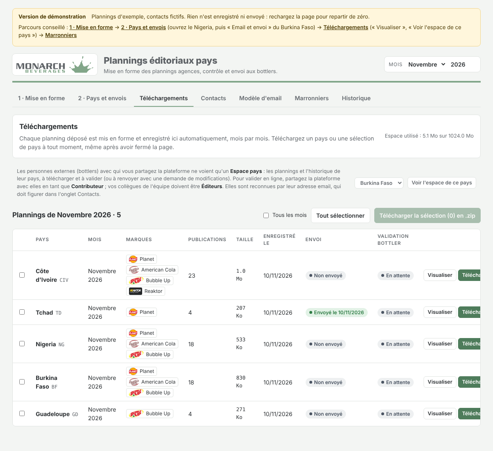
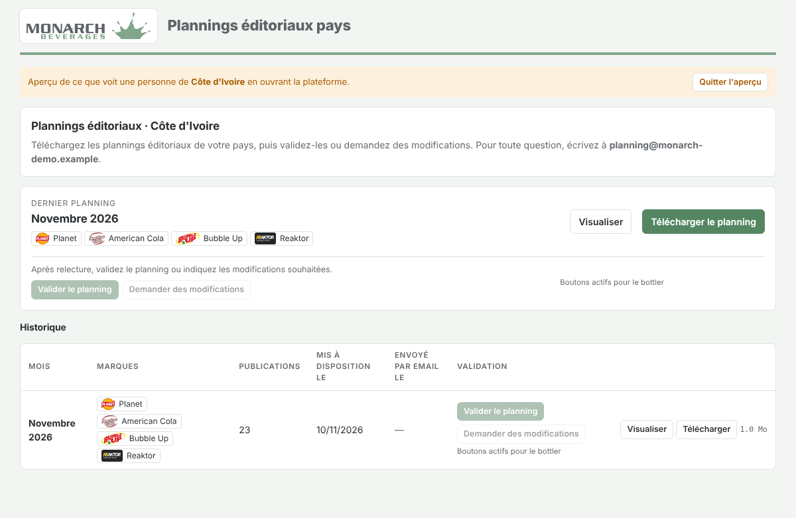
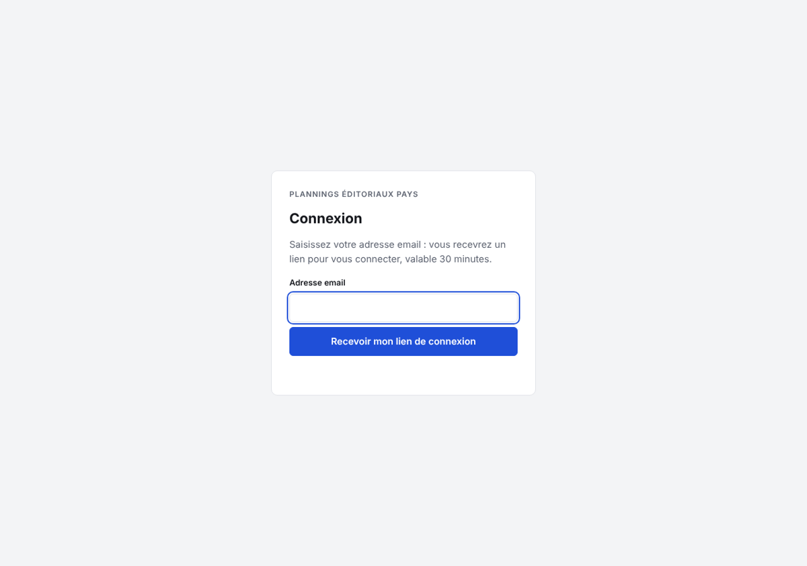

# Plannings éditoriaux pays

Plateforme interne de **Monarch Beverages** pour recevoir les plannings éditoriaux des agences, les contrôler pays par pays, les mettre en forme et les transmettre aux bottlers.

Chaque mois, les agences livrent un fichier Excel par pays (Côte d'Ivoire, Cameroun, Nigeria, Ghana…). La plateforme remplace le travail manuel de vérification, de mise en page et d'envoi.



---

## Ce que fait la plateforme

Le travail se fait en deux étapes enchaînées :

1. **Mise en forme** : les plannings des agences sont transformés en un fichier propre par pays.
2. **Pays et envois** : chaque pays est positionné **En révision** (avec un motif, par exemple « en attente des vidéos ») ou **Prêt pour l'envoi**, contrôlé, puis envoyé. Un planning en révision ne peut pas être envoyé tant qu'il n'est pas validé. Les statuts sont conservés, et les plannings mis en forme peuvent être repris plus tard, même après fermeture de la page.

### 1. Dépôt
Glissez les fichiers des agences (plusieurs à la fois). Le pays et le mois sont reconnus à partir du nom du fichier, par exemple `CIV - PE NOVEMBRE 2026.xlsx`. Textes, thématiques, commentaires et visuels intégrés sont lus automatiquement.

### 2. Contrôle
Pour chaque pays, deux niveaux :

- **Erreurs**, qui bloquent l'envoi :
  - une marque distribuée dans le pays manque dans le planning ;
  - le pays n'est pas reconnu ;
  - aucun destinataire n'est enregistré.
- **Remarques**, pour information :
  - marronnier du pays non traité ;
  - post qui reprend le marronnier d'un autre pays ;
  - textes dans la mauvaise langue (anglais attendu au Nigeria et au Ghana, par exemple) ;
  - texte à compléter (`[@NomDuGagnant]`) ;
  - visuel manquant.

Seules les **marques distribuées dans le pays** sont incluses dans le fichier envoyé. Une marque non prévue est écartée automatiquement, et peut être réintégrée d'un clic.

### 3. Marronniers
Le calendrier marketing de l'année (import du fichier Excel) indique, pour chaque marronnier, les pays et les marques concernés. La plateforme vérifie que chaque pays traite ses marronniers. Elle signale aussi ceux qui apparaissent dans un planning sans figurer au calendrier.



### 4. Mise en forme des plannings agences
L'espace **Mise en forme** accepte aussi les plannings « compilés » des agences, qui regroupent plusieurs pays et plusieurs mois. On y voit le texte FR, la traduction EN, les visuels, les commentaires de production, les retours MB et le budget. Pour chaque pays destinataire, la plateforme ne garde que :

- les publications du mois choisi ;
- les posts communs ;
- les marronniers du pays, repérés par drapeau ou code pays.

Les pays anglophones reçoivent le texte anglais. Les posts refusés dans les retours MB sont écartés, et chaque publication peut être cochée ou décochée. Les colonnes **Commentaires, Retours et Budget ne sont jamais transmises**. Le résultat se télécharge (un fichier par pays) ou s'ajoute directement aux envois des pays.



Dans les deux cas, chaque pays reçoit un fichier Excel propre :

- une page de récapitulatif, puis un onglet par marque aux couleurs de la marque ;
- les publications regroupées par semaine, chaque visuel aligné sur sa publication ;
- uniquement les colonnes utiles au bottler : date, jour, thématique, texte, visuel ;
- des en-têtes en français, en anglais ou en espagnol selon le pays.

### 5. Envoi
Chaque pays reçoit l'un des trois modèles d'email, choisi dans l'onglet Contacts :

| Modèle | Pays par défaut | Contenu |
|---|---|---|
| Anglais | Nigeria, Ghana, Argentine | *For your information, please find the … editorial calendar…* |
| Français – information | Guadeloupe, Vanuatu | *Veuillez trouver le planning éditorial…*, sans demande de validation |
| Français – avec validation | autres pays | *… Merci de bien vouloir nous confirmer que ce planning vous convient.* |

Le mois et la liste des marques (« Planet, Bubble Up et American Cola ») sont remplis automatiquement. Le **lien de téléchargement** (SwissTransfer, WeTransfer…) se renseigne par pays et devient cliquable dans l'email. Un bouton le reporte sur tous les pays du même modèle. Joindre aussi le fichier Excel est facultatif.

La plateforme fournit un **brouillon Outlook (.eml)** prêt à envoyer depuis contact20@exemple.example. Un pack réunit tous les pays en une fois. Chaque envoi est enregistré dans l'historique.

### 6. Téléchargements et Espace pays
Tous les plannings mis en forme sont conservés, mois par mois, et restent téléchargeables à tout moment.



Les **bottlers** se connectent à leur **Espace pays**. Ils n'y voient que les plannings et l'historique de leur pays, en téléchargement uniquement.



---

## Accès

| Qui | Accès |
|---|---|
| Équipe Monarch (adresses déclarées dans la configuration) | Toute la plateforme |
| Bottlers (adresses présentes dans l'onglet Contacts) | Leur Espace pays uniquement |
| Toute autre adresse | Aucun |

La connexion se fait **par lien envoyé par email**, sans mot de passe. L'équipe peut aussi générer des liens d'accès pour les bottlers depuis l'onglet Contacts. Les droits sont vérifiés par le serveur.



---

## Installation

La plateforme s'installe avec **Docker** chez n'importe quel hébergeur : serveur ou VPS, serveur interne, Render, Railway… Le HTTPS est automatique.

```bash
cp .env.example .env            # nom de domaine, adresses de l'équipe
docker compose up -d --build
docker compose exec app node server/index.js lien contact20@exemple.example
```

Guide complet : **[docs/INSTALLATION.md](docs/INSTALLATION.md)**. Il couvre les prérequis, la première connexion, l'accès des bottlers, le SMTP facultatif, les sauvegardes et les mises à jour.

## Données de départ

Au premier démarrage, la plateforme charge `server/seed.json` :

- les contacts des 13 pays (Cameroun, Congo, Côte d'Ivoire, Guinée, Mali, Sénégal, Tchad, Nigeria, Ghana, Burkina Faso, Guadeloupe, Vanuatu, Argentine) ;
- le calendrier marketing 2026 ;
- l'expéditeur des emails.

> Ce dépôt contient des noms et adresses email de contacts : il doit rester **privé**.

## Technique

Node.js 22 (Express), SQLite, Caddy pour le HTTPS. La lecture et la mise en forme des fichiers Excel se font dans le navigateur (ExcelJS). Détails et structure du code : [docs/INSTALLATION.md](docs/INSTALLATION.md).
